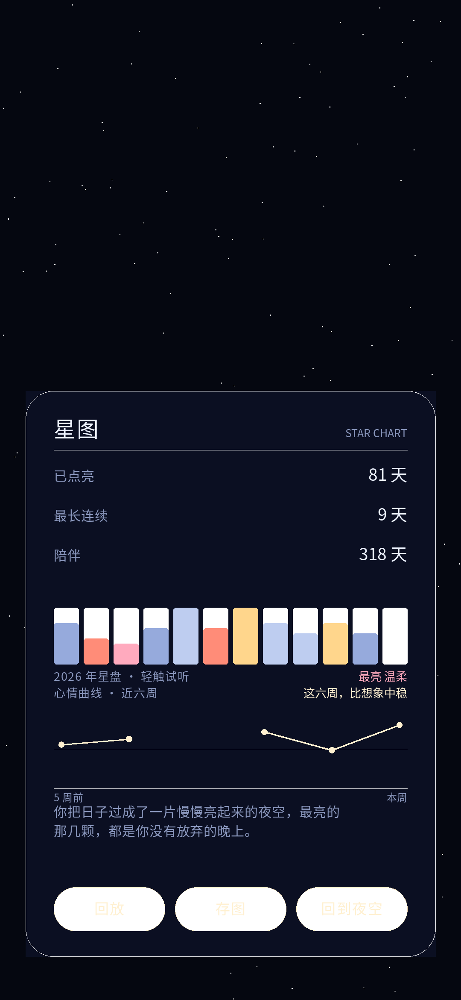
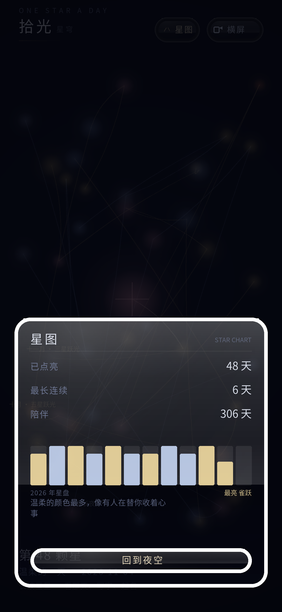

# 拾光 OneStar

一个**完全不用 Gradle、不用 Android Gradle Plugin** 的原生 Android 应用：桌面小组件 + 手绘星空 Canvas 界面 + 手工维护的 JNI 层，构建链路由 `aapt2 / javac / d8 / apksigner` 手工串起来，全部代码可直接在命令行编译出 APK。

> 这个仓库的重点不是"一个记日记的 App"，而是**一套可复现的、脱离 Gradle 的 Android 构建实验**。如果你也好奇 AGP 到底替你做了哪些事，这里有一份能跑通的答案。



| 星图总览 | 长按星语 | 应用图标 |
| --- | --- | --- |
|  |  |  |

---

## 1. 这个项目是什么

拾光（OneStar）是一款轻量的"每日星"记录 App：每天记一笔心情，界面用 Canvas 逐帧绘制，记录会累积成一片星图；支持桌面小组件、心情曲线、年度长图海报、旋律提示音与 5 秒可撤销的删除。

技术上它刻意**回避了现代 Android 的标准做法**，用来验证一条更"手工"的路线是否仍然可行：

- 没有 Gradle 工程文件，没有 `build.gradle`，没有 `settings.gradle`
- 没有 AndroidX，没有 Material Components，没有第三方 SDK
- 全部界面自绘（`Canvas` + 手写坐标布局），不依赖 XML 布局膨胀
- 全部字符串/资源手写，`aapt2` 直接处理 `res/`
- 二进制层只是一层薄 JNI，编译靠 `zig cc`（不装 NDK）

## 2. 构建链

```text
res/  ──aapt2 compile──►  res.zip
                             │
AndroidManifest.xml ──aapt2 link──►  未签名 APK（含 R.java + assets/）
                             │
java/ + gen/ ──javac(source 8)──►  classes/
                             │
classes/ ──d8 --min-api 21──►  classes.dex ──► 打入 APK
                             │
jni/src/*.c ──zig cc (aarch64-linux-musl)──►  lib/arm64-v8a/*.so ──► 打入 APK
                             │
tools/zip16k.py ──►  16 KB 页对齐重打包（.so 以 STORED 存放并对齐 16384）
                             │
apksigner sign ──►  onestar-<version>-signed.apk
```

对应脚本就是仓库根的 `build.sh`，一共 200 来行 Bash。

## 3. 快速开始

### 3.1 环境要求

| 依赖 | 版本 | 说明 |
| --- | --- | --- |
| JDK | 17+ | 只需要其中的 `javac` / `keytool` |
| Android SDK build-tools | 34+ | 提供 `aapt2` / `d8` / `apksigner` |
| Android SDK platform | android-35 | 提供 `android.jar` |
| Python | 3.8+ | 仅用于 `tools/zip16k.py` |
| zig | 0.11+ | 可选，用于编译 `jni/src/*.c`；不提供则跳过原生库 |

### 3.2 构建

```bash
# 最小用法：用默认 debug 签名出一个可安装的 APK
ANDROID_HOME=$HOME/Android/Sdk ./build.sh

# 编译 JNI 并用自己的签名
ANDROID_HOME=$HOME/Android/Sdk \
JAVA_HOME=/path/to/jdk-17 \
ZIG=$(command -v zig) \
ONESTAR_KS=release.keystore ONESTAR_KS_PASS=****** ONESTAR_KS_ALIAS=onestar \
./build.sh
```

产物在 `build/onestar-<versionName>-signed.apk`。

可用环境变量：`ANDROID_HOME` / `ANDROID_SDK_ROOT`、`BUILD_TOOLS`、`JAVA_HOME`、`MIN_SDK`（默认 21）、`TARGET_SDK`（默认 35）、`ABIS`（默认 `arm64-v8a`）、`ZIG`、`ONESTAR_KS` / `ONESTAR_KS_PASS` / `ONESTAR_KS_ALIAS`。

### 3.3 跑单测（不需要模拟器、不需要 android.jar）

```bash
JAVA_HOME=/path/to/jdk-17 ./test.sh
```

`test.sh` 会自动挑出不 `import android.*` 的纯逻辑类，与 `test/` 下的断言程序一起用普通 `javac` 编译，然后逐个跑 `main`。目前 9 个测试类、共 3131 项断言（其中前 7 类合计 221 项，多语言两层合计 2910 项）：

| 测试类 | 覆盖对象 | 断言数 |
| --- | --- | --- |
| `CompatTableTest` | 系统版本 / 页大小 / 内存档位映射 / 页大小说明文案 | 38 |
| `V4LogicTest` | 星轨回放与曲线取样 | 59 |
| `ConstellationTest` | 星座与星名生成 | 31 |
| `V62LogicTest` | 补记标记、撤销快照的编解码兼容 | 26 |
| `NoteTextTest` | 备注文本折行与截断 | 24 |
| `DayEditTest` | 日记录编辑状态机 | 23 |
| `MelodyTest` | 旋律序列与节拍 | 20 |
| `I18nTableTest` | 多语言表完整性、语言判定、日期/数字本地化 | 2818 |
| `I18nTest`（`com.yangyang2857rgb.onestar` 包） | 外语模式下各逻辑类输出不得残留汉字 | 92 |

这类"把可纯化的逻辑抽出来，用 JVM 断言兜住"的做法，是这个工程能长期手工演进而不至于崩掉的主要原因。

## 4. 工程结构

```text
.
├── AndroidManifest.xml          # 单 Activity + 一个 AppWidget receiver
├── build.sh                     # 无 Gradle 构建脚本
├── test.sh                      # 纯 JVM 单测入口
├── assets/
│   └── COPYRIGHT.txt            # 署名信息（随 APK 打包，也用于版本内说明）
├── docs/
│   ├── release-spec.md      # 版本号规则与发布纪律
│   ├── version-timeline.md  # 历代版本与旧流水号对照
│   └── screenshots/         # README 引用的截图
├── java/com/yangyang2857rgb/onestar/
│   ├── MainActivity.java        # 入口，手势/生命周期
│   ├── StarFieldView.java       # 核心自绘视图（3036 行）
│   ├── I18n.java                # 15 种语言文案表（3242 行，全仓最大）
│   ├── TextDraw.java            # Canvas 文字绘制与 RTL 视觉重排
│   ├── DaysStore.java           # SharedPreferences 存储读写
│   ├── DaysCodec.java           # 记录行编码/解析（纯逻辑，可单测）
│   ├── DayEdit.java             # 编辑状态机（纯逻辑）
│   ├── Constellation.java       # 星座/星名（纯逻辑）
│   ├── StarName.java            # 星名中英对照（纯逻辑）
│   ├── ChimePlayer.java         # 提示音播放
│   ├── MoodCurve.java           # 心情曲线采样
│   ├── Replay.java              # 星轨回放
│   ├── Melody.java              # 提示音旋律
│   ├── NoteText.java            # 备注折行
│   ├── PosterRenderer.java      # 年度长图海报
│   ├── StarWidget.java          # 桌面小组件
│   ├── WidgetState.java         # 小组件状态（纯逻辑）
│   ├── Compat.java / CompatTable.java  # 系统能力适配（后者纯逻辑）
│   └── NativeCore.java          # JNI 声明与纯 Java 回退
├── jni/
│   ├── include/                 # 交叉编译所需的极简头
│   └── src/{ons_page,ons_dsp,ons_curve}.c
├── res/                         # 手写 drawable / mipmap / xml（含 locales_config.xml）
├── tools/zip16k.py              # 16 KB 对齐重打包
└── test/                        # 纯 JVM 断言程序
```

## 5. 两个值得单独说的技术点

### 5.1 16 KB 页大小对齐

Android 15 起部分设备使用 16 KB 内存页，未按 16 KB 对齐的 `.so` 会加载失败。build-tools 34 的 `zipalign` 还不支持 `-P 16`，因此这里自己写了 `tools/zip16k.py`：把 `lib/**/*.so` 以 STORED（不压缩）方式重打包，并用 ZIP extra field 把数据偏移顶到 16384 的倍数，其余条目按 4 字节对齐。脚本自带 `--check` 校验，构建末尾会打印每个 `.so` 的实际偏移与对齐结果。

### 5.2 不装 NDK 的 JNI

`jni/src` 只有三个很薄的 C 文件（页面索引、采样、曲线），全部 `-nostdlib` 编译，头文件只需 JDK 自带的 `jni.h` 加极简桩。用 `zig cc --target aarch64-linux-musl` 交叉编译，省掉数 GB 的 NDK。`NativeCore` 在库缺失时自动退回纯 Java 实现，因此不提供 `ZIG` 也能构建、也能跑（性能略降）。

## 6. CI

`.github/workflows/android.yml` 是一份开箱即用的工作流：在 Ubuntu 上装 build-tools 34 与 platform 35，先跑 `test.sh` 再跑 `build.sh`，把签名后的 APK 作为 workflow artifact 上传。整个流水线同样不含 Gradle。

触发方式：推送到 `main`、打 `v*` 标签，或在 **Actions → build → Run workflow** 手动执行。产物在该次运行的 Artifacts → `onestar-apk`。

## 7. 已知限制

- 只构建 `arm64-v8a`；需要其他 ABI 时改 `ABIS` 并自行加交叉工具链目标
- 界面坐标按竖屏固定比例手算，极端屏幕比例下需要调参
- Release 页面与 CI 产物使用的是仓库内固定生成的 **debug 证书**签名。这样做的目的是让每次构建的证书指纹一致、已装用户可以直接覆盖升级；代价是这个证书对所有人可见，任何人都能伪造同签名名的更新包，因此它只适合自用、体验与验证构建链，**不能上架应用商店，也不适合对外分发**。要正式分发必须换成自己的 release keystore（`ONESTAR_KS` / `ONESTAR_KS_PASS`），届时老用户需要卸载重装才能升级
- 多语言覆盖 15 种语言（简繁中文、英、日、韩、法、德、西班牙（西班牙/拉美）、阿拉伯、泰、巴西/欧洲葡萄牙、藏、维吾尔），全部由 `I18n.java` 的文案表与 `TextDraw` 的 RTL 重排实现，没有引入第三方 i18n 框架；界面文案不依赖 `res/values-*`，`res` 里只有系统读取的图标名、小组件标题等少数条目，并由 `res/xml/locales_config.xml` 接入 Android 13 的「应用语言」入口
- 无障碍为部分适配：v6.8 起顶部胶囊按钮向 TalkBack 暴露 Button 角色与 `contentDescription`，并把可点区放大到不小于 48dp；完整的无障碍树、焦点遍历顺序与朗读节奏仍未系统梳理

## 8. 版本

版本记录见 [CHANGELOG.md](CHANGELOG.md)。可直接安装的 APK 放在仓库的 **Releases** 页面，源码仓库内不存放二进制。

发版纪律与版本号规则见 [docs/release-spec.md](docs/release-spec.md)；历代版本、旧流水号与语义化版本号的对应关系见 [docs/version-timeline.md](docs/version-timeline.md)。

## 9. 许可

代码以 [MIT License](LICENSE) 发布。`assets/COPYRIGHT.txt` 中的署名信息请随分发保留。

---

作者：王孙阳（Wang Sunyang）· 独立开发
